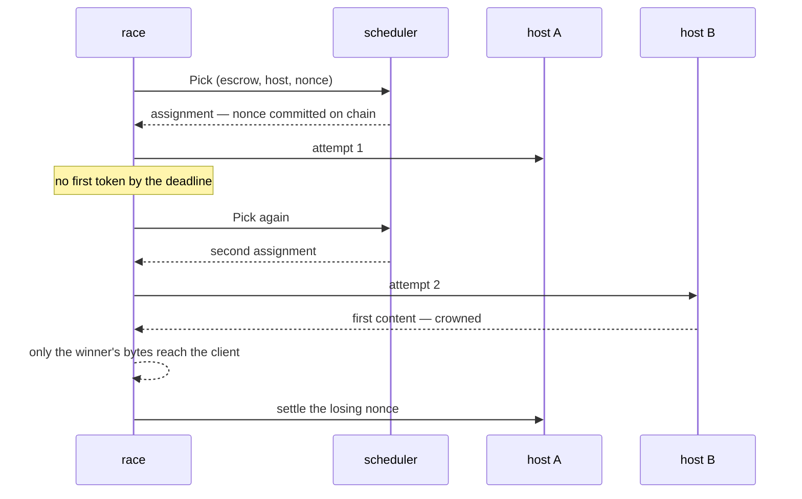

# The request path

One `POST /v1/chat/completions`, from the socket to the settled nonce. Every step names the file and function that does it.

## Order of operations

`api/routes.go`, `handleChat` → `chat` → `race`.

| # | Step | Where | Fails with |
| --- | --- | --- | --- |
| 1 | read the body, capped at 10 MiB | `readBody`, `chatIngestLimit` = `filters.MaxBodyBytes` | 413 |
| 2 | normalise the request | `filters.NormalizeRequest`, options from `filterOptions` | 400 |
| 3 | will it fit a host-bound body once encoded | inline in `chat`: `transport.PromptWireBytes` + `hostCatchUpReserveBytes` against `transport.MaxHostRequestBytes` | 413 |
| 4 | authorise the model for this caller | `authorizeModel` | 400 when the model is absent; 401 |
| 5 | is the model routable at all | `routableModel`, for a caller step 4 admitted | 503 when not ready or an offered model has nothing routable; 400 for a model nobody offers |
| 6 | does the chain phase admit new work | `admission`, on `snapshots.Snapshot()` | 503, except a refusal that is proof-of-compute alone, which waits for step 7 |
| 7 | cache lookup | `cacheKeyFor` → `cache.get` | — (hit returns here); a miss behind a proof-of-compute refusal answers that 503 |
| 8 | take an admission slot and token budget | `limiter.AcquireForModel` | 429 |
| 9 | does the chain phase still admit new work | `admission` again, on a fresh snapshot: the limiter can hold a request for minutes, and a block that began meanwhile must not get a nonce | 503 |
| 10 | race it | `race` → `engine.Run` | see below |
| 11 | release the slot | `defer limiter.ReleaseForModel` | — |

Steps 4–6 run **after** normalisation because the model name is only known once the body is parsed and the per-model profile applied.

## Step 2 in detail: `filters.NormalizeRequest`

`filters/pipeline.go`, `runPipeline`, in this order:

1. `unwrapExtraBody` — hoist `extra_body` into the top level.
2. `rejectUnknownParameters` — a parameter absent from the table is refused. The gateway does not forward what it has not been taught.
3. `applyStage(StagePreValidation)` — type and range checks, strips.
4. `normalizeMessages` → `validateMessages` — message hygiene, separate because a message is a nested document.
5. `decodeRequestView` — the typed view of what the client asked for.
6. `applyOutputTokenLimits` — default and cap, per model.
7. `decodeLogprobIntent` — **read here, before the next stage**, because `StagePostLimits` forces logprobs on and afterwards the document says what the gateway wants, not what the client asked.
8. `applyStage(StagePostLimits)` — the forcing stage: `logprobs`, `top_logprobs`, `n → 1`, and each model profile's own forces ([`filters/README.md`](../filters/README.md), "Model profiles").
9. `forceUpstreamStreaming` — unless `force_upstream_streaming` is off.
10. `document.Marshal` → `Result`.

`Result` carries the normalised body plus what the **client** asked for: `ClientStream`, `ClientUsage`, `Logprobs`, `MaxTokens`. The body and the intent diverge, and that divergence is the whole response side.

### The rule table

`filters/table.go` is one row per top-level parameter: name, stage, rule. Per-model divergences live in `filters/presets/<name>.json`; an operator binds a model to a preset, or sets knobs over its own, through `/v1/admin/filters` ([`filters/README.md`](../filters/README.md), "Model profiles").

| Forced regardless of the client | Why |
| --- | --- |
| `logprobs: true`, `top_logprobs: 5` | validators re-execute and compare distributions |
| `n: 1` when present | reservation budgets one `max_tokens` output; `n` choices can produce `n` times what was signed for |
| `stream: true` | the gateway needs the stream to time the first token and spot a stall |

The executor forces `logprobs` and `top_logprobs` itself, and `return_token_ids: true` beside them (`common/completionapi.ModifyRequestBodyWithLogprobsMode`), so the gateway's copies of `logprobs` and `top_logprobs` are belt and braces on the committed payload rather than the only guard. `return_token_ids` is the executor's alone: the gateway strips it from the client's request.

## Step 9 in detail: the race

`api/routes.go`, `race` → `engine.Run` (`engine/engine.go`).

The escalation ladder (`engine/escalation.go`) measures each stage against the host's own history, not a fixed timeout: receipt, first token, inter-chunk silence. `MaxAttemptsPerRequest` bounds the **total** attempts including the primary.

## The response side

Two shapes, decided by what the client asked for, not by what the host sends — the host always streams.

**Streaming client** — `filters.StreamRewriter` (`filters/stream.go`): each event is parsed, stripped, and forwarded as it arrives. A partial event is held in a carry bounded by `MaxStreamCarryBytes` (32 MiB).

**Non-streaming client** — `filters.BodyFolder` (`filters/fold.go`): events are folded into the answer **as they arrive**, and the internal fields are removed *before* merging. What the request holds is the answer being assembled, not the stream it came from. `api/stream.go`'s `Close` then chooses the status from the assembled body — a body the assembler could not fold is answered 502, never 200 with an error object inside.

### What a client can and cannot see

`filters/response.go`:

| Field | Returned? |
| --- | --- |
| `logprob`, `logprobs`, `top_logprobs` | only if the client asked (`logprobs: true`) |
| `token_ids`, `prompt_token_ids`, `prompt_logprobs` | never |

The "always stripped" list is **derived** from the two above, not written out a second time — a second hand-written list can omit a field the first strips, which leaks `top_logprobs`.

## Memory

| Bound | Value | What it bounds |
| --- | --- | --- |
| `chatIngestLimit` | 10 MiB | one request body as it arrives |
| `transport.MaxHostRequestBytes` | 10 MiB | one request body as a host receives it |
| `hostCatchUpReserveBytes` | 1 MiB | the room inside that body kept for the escrow's catch-up |
| `MaxStreamCarryBytes` | 32 MiB | one unterminated SSE event |
| `maxBufferedResponseBytes` | 32 MiB | one reply being assembled |
| `max_buffered_response_bytes` | 512 MiB | **every** reply being assembled, and every reply being recorded for the response cache, at once; a recording the budget cannot hold stops and that reply is not cached, while the client still receives it whole. Recordings and assemblies spend the one budget, so a non-streamed reply that is also recorded is counted twice while both copies are held, and an assembly refused while recordings fill the budget is answered 503 like any other |

The two 10 MiB bounds are not the same bound. A prompt travels base64 inside the host-bound JSON, so it costs four bytes for every three, and the catch-up diffs ride the same body. A request inside the ingest cap can therefore be past what the public proxy, the versiond router and a host accept — the shape [issue #1658](https://github.com/gonka-ai/gonka/issues/1658) reported. Step 3 refuses it before a nonce is spent. When the catch-up backlog is what would not fit, it is drained ahead of the request instead of riding it ([`user/session.go`](../../../user/session.go), `drainOversizedCatchUp`), and each drained chunk is cut by wire bytes rather than by diff count — a chunk a host refuses whole leaves its sync cursor where it was, so the next attempt rebuilds the same backlog, which is the loop [issue #1660](https://github.com/gonka-ai/gonka/issues/1660) describes. Only a body that still does not fit is refused at the send with `transport.ErrHostRequestTooLarge`.

**A session keeps only the newest diffs in memory.** A stored session holds the newest 1024 diffs and trims back to that once 2048 accumulate; the rest stay in the escrow's store (`user/session.go`, `trimDiffsLocked`). A host whose cursor is older than what memory holds — one far behind, one rewound to nonce 0 after it lost the escrow, or one left behind across a restart — is first taught the gap from the store: 1024 diffs per read, read without the session's lock so the escrow's other hosts are not held, each page cut into the same wire-bounded chunks (`closeStoredGap`). Only then does the request go out, carrying the in-memory tail and its own diff. The inference, heartbeat, pending-diff and finalize paths and a timeout vote all go through it (`catchUpForRequest`), so no host-bound body is sized by how far a host lags. A store read that fails sends nothing: the request fails, `catch_up_store_read_failed` names the range, the cursor stays where it was, and the next request to that host tries again. The one store read made under the lock is a single row: the post-state root of a nonce memory no longer holds, when a response reports one (`storedPostStateRoot`).

**Step 3 reserves room for the catch-up rather than measuring the prompt alone.** The diffs are the gateway's own state and a client cannot be refused for them, so the check asks whether the prompt fits inside `MaxHostRequestBytes` *less* `hostCatchUpReserveBytes`. Measuring the prompt against the whole budget admits a body that leaves nothing for the backlog, and the refusal then lands at the send — after the nonce is committed, which spends the escrow's reserve on nobody, and the exemption ladder is what keeps it off the host's record ([race.md](./race.md), "The exemption ladder"). The reserve is a trade, and the numbers are worth stating: the prompt ceiling falls from about 7.86 MB to about 7.07 MB, which covers an ordinary backlog of a few thousand small diffs, while closing the hazard outright would mean reserving the full 4 MiB a backlog may ride inline and giving up roughly 40% of the usable prompt. What is left over is refused as the gateway's own limit rather than charged to a host.

The last one exists because the request limiter does not stand in for it: with `max_concurrent_requests` unset the cap comes from network weight and admits thousands at a time. Past it, a request is refused 503; `devshard_gateway_buffered_response_bytes` is what is held right now.

## Compression to the host

A chat request is gzipped only from 4 KiB up (`app.chatCompressMinBytes`, carried to the transport as `transport.ClientConfig.ChatCompressMinBytes`). A typical request, prompt and catch-up together, is 1–3 KiB, where gzip saves about 1 KiB on the wire but costs about 28 µs and a fresh 814 KB `flate` writer: Connect pools its compressors in a `sync.Pool`, which garbage collection drains, so under load most messages build the writer again. Below the threshold the request goes out as it is, which the host's Connect handler accepts like any other; above it a long prompt or a large backlog is still compressed. Clients that leave the field at zero, hosts among them, gzip every request.

## Where to change what

| To change | Go to |
| --- | --- |
| a parameter's validation or default | `filters/table.go`, and `filters/rules_*.go` for the rule body |
| how one model differs | `filters/presets/<name>.json` |
| what a client may see back | `filters/response.go`, `clientStrippedFields` / `requestableFields` |
| the status a failure gets | `api/errors.go`, `statusForError` |
| when a second attempt starts | `engine/escalation.go` |
| which escrow is picked | `scheduler/scheduler.go` |
| what a cache entry keys on | `api/cache.go`, `cacheKeyFor` |
